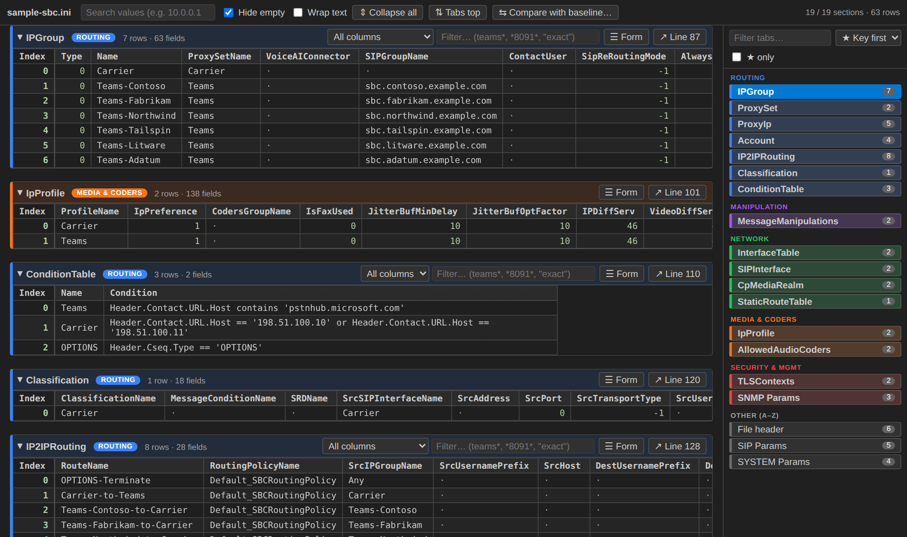
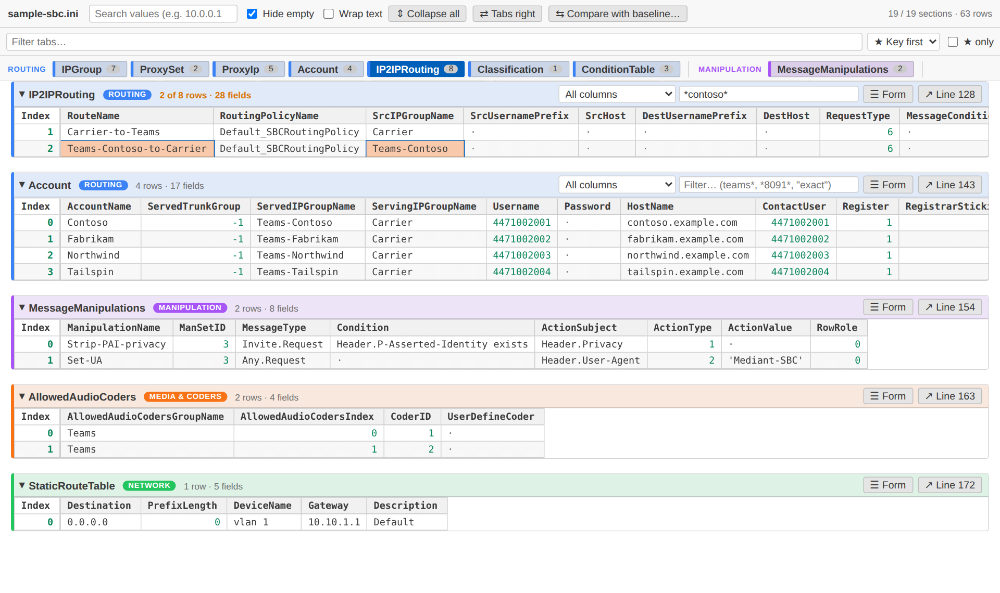
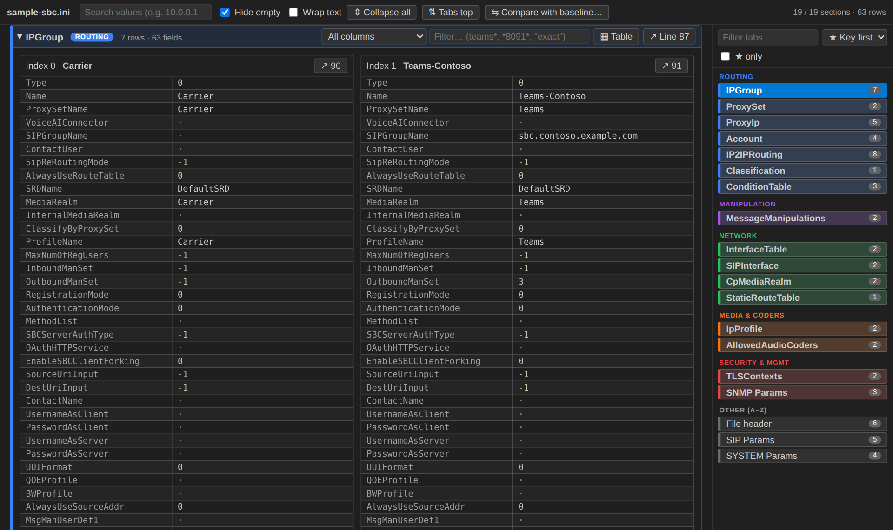
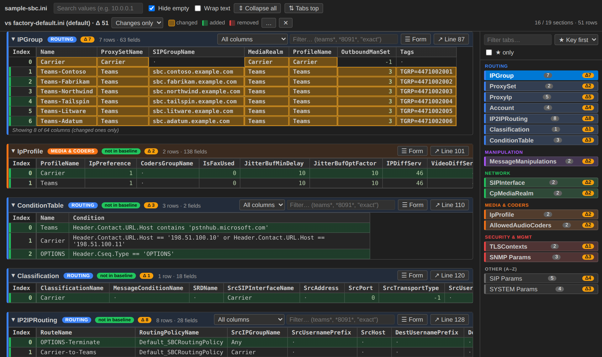

# INI Table View

Opens `.ini` files as bordered, aligned tables with clickable section tabs.
Built for AudioCodes SBC config INIs (`FORMAT Index = ...` tables, `[ Section ] ... [ \Section ]`), and works on plain INI too.

## Features
- Every section rendered as a bordered table — sticky header row and sticky Index column for wide tables (IPGroup, IPProfile…)
- Section tabs at the **top** or on the **right** (toggle button, or `iniTableView.navPosition`), with row counts; active tab follows your scroll
- **Form view** per section — one card per row, field | value — for tables too wide to read across
- Filter sections by name; search values across the whole file (matching rows only, highlighted)
- Per-section filter on every table, optionally scoped to one column — `teams` (contains), `teams-oc*` / `*8091*` / `?` (wildcards), `"OC-Anchor"` (exact). Esc clears
- Columns size to their content; drag a header edge to resize, double-click the edge to auto-fit
- Hide empty sections (on by default)
- Double-click a row or hit `↗ Line N` to jump to that line in the raw text beside it
- Alt+click a cell to copy its value
- Live refresh while you edit the text version
- Ctrl/Cmd+F → value search, Ctrl/Cmd+Shift+F → section filter

## Screenshots

**Filter any table**, with wildcards, by one column or all of them:

**Form view**: one card per row for very wide tables:

**Compare with a factory default**: only what you changed, down to the cell:

## Compare with a baseline
Click **⇆ Compare with baseline…** and pick a default or golden INI (e.g. a fresh-install export).
- **Amber cell**: value differs from the baseline (hover to see the baseline value)
- **Green row**: not in the baseline (added)
- **Red, struck-through row**: in the baseline but missing here (removed)
- **Changes only**: hides unchanged sections, rows and columns, so a 139-column IpProfile shows just the fields that changed

New rows are compared with the baseline's default row of the same table (e.g. IPGroup 0 `Default_IPG` in a factory-default export), so only the cells you changed from default light up.

Deployment-specific items are skipped via `iniTableView.diffIgnore`. By default that covers the interface, static route, device, port and Ethernet-group tables and `SYSTEM Params/HALocalMAC`.

Use it for one file, or for every INI via `iniTableView.defaultBaseline`. Sections are matched by name, rows by index or key, and columns by name, so baselines from other firmware versions still line up.

## Key sections
Key sections (IPGroup, ProxySet, IP2IPRouting, ConditionTable, IpProfile, TLSContexts…) are bold and colour-coded by group. Tab order: ★ Key first (grouped), A → Z, or File order. Edit the groups, colours and names in Settings → `iniTableView.keySections`.

## Opening INI files as tables
.ini files open as normal text by default, so php.ini, desktop.ini and friends are left alone. To use the table view:
- click the table icon in the editor title bar (**INI: Open as Table**), or right-click an .ini → **INI: Open as Table**
- to make it the default for every .ini, run **INI: Always Open .ini Files as Tables** from the Command Palette. You're also offered this the first time you open a table. Undo it with **INI: Stop Opening .ini Files as Tables by Default**.

## Switching views
Title-bar buttons: **INI: Open as Text** / **INI: Open as Table**, or right-click the tab → *Reopen Editor With…*
